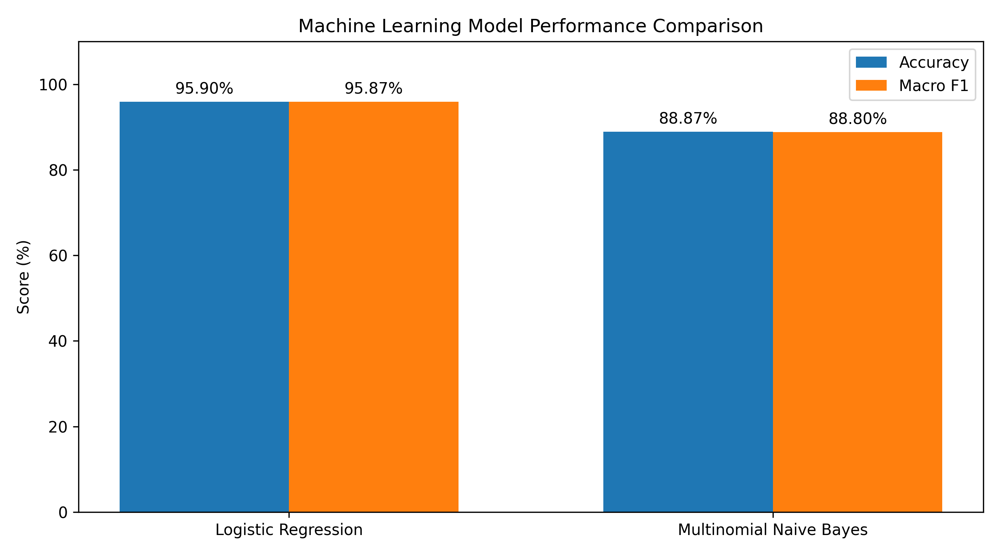
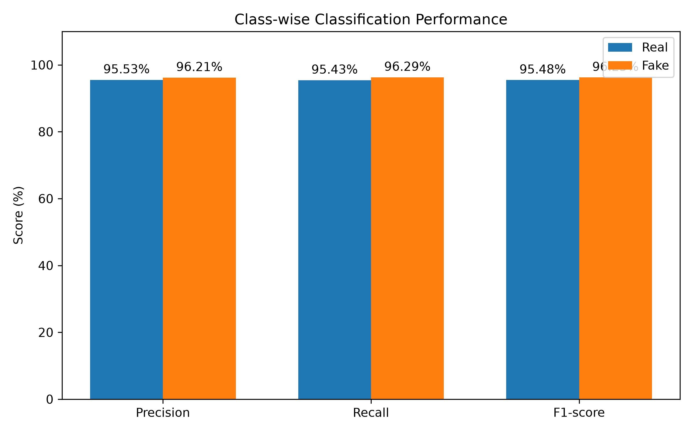
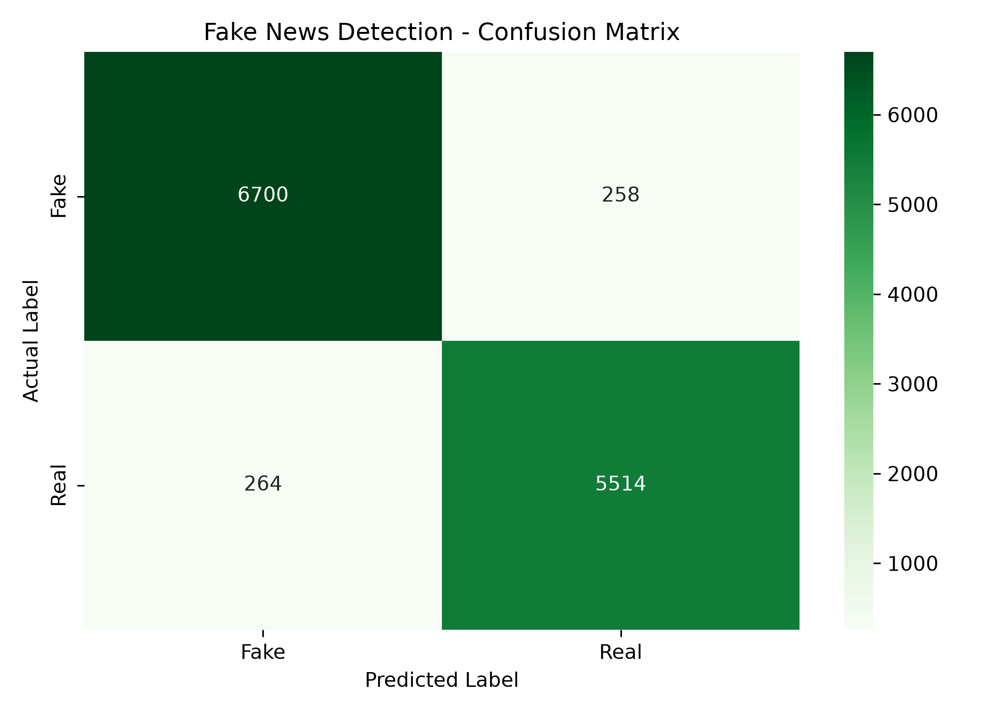

# Fake News Detection System


A machine-learning project that classifies news text as **Fake** or
**Real** by learning textual patterns from the WELFake dataset, using
TF-IDF features and Logistic Regression.

**Subject:** Artificial Intelligence (843) \| **Project type:** CBSE
Class XII Capstone Project **Author:** Sajid Ekbal Choudhury\
**School:** PM SHRI Kendriya Vidyalaya 210 CoBRA CRPF Dalgaon, Assam\
**Academic year:** 2026--27

> **Project status:** The machine-learning pipeline (data cleaning,
> training, model comparison, evaluation and command-line testing) is
> **complete**. The Flask web application is **planned and not yet
> implemented**.

------------------------------------------------------------------------

## Table of Contents

1.  [Project Overview](#1-project-overview)
2.  [Problem Statement](#2-problem-statement)
3.  [Objectives](#3-objectives)
4.  [Key Features](#4-key-features)
5.  [Technology Stack](#5-technology-stack)
6.  [Dataset: WELFake](#6-dataset-welfake)
7.  [Methodology](#7-methodology-tf-idf--logistic-regression)
8.  [Model Evaluation](#8-model-evaluation)
9.  [Confusion Matrix](#9-confusion-matrix)
10. [Project Structure](#10-project-structure)
11. [Installation and Setup](#11-installation-and-setup)
12. [Running the Existing ML
    Scripts](#12-running-the-existing-ml-scripts)
13. [Limitations and Ethical
    Considerations](#13-limitations-and-ethical-considerations)
14. [Disclaimer](#14-disclaimer)
15. [Documentation](#15-documentation)

------------------------------------------------------------------------

## 1. Project Overview

This project builds a text classifier that estimates whether a news
article resembles the **Fake** or **Real** examples in the WELFake
dataset. Article text is converted into numerical features with
**TF-IDF** (unigrams and bigrams), and a **Logistic Regression**
classifier is trained on those features. The trained model is saved as a
single scikit-learn `Pipeline`, so raw text can be passed straight to it
for prediction.

The system detects **patterns in language learned from its training
data**. It does **not** verify facts, check sources, or determine
whether a claim is true.

## 2. Problem Statement

Misleading news spreads quickly online, and manually reviewing every
article is not practical. This project explores whether a lightweight,
interpretable machine-learning model can recognise the linguistic
patterns that distinguish articles labelled *fake* from those labelled
*real* in a public dataset, and how reliably it does so on unseen test
data from that same dataset.

## 3. Objectives

-   Clean and audit the WELFake dataset to produce a consistent training
    file.
-   Build a TF-IDF + Logistic Regression text-classification pipeline.
-   Compare the pipeline against a second algorithm (Multinomial Naive
    Bayes).
-   Evaluate the chosen model using accuracy, precision, recall,
    F1-score and a confusion matrix.
-   Provide a command-line tool to test the trained model on new text.
-   *(Planned)* Provide a Flask-based web interface for the trained
    model, with clear wording that results are pattern-based predictions
    and not fact-checks.

## 4. Key Features

### Completed (machine learning)

-   Dataset inspection and audit scripts (missing values, duplicates,
    empty articles, conflicting labels).
-   Data cleaning that builds a combined `title + article` text field.
-   TF-IDF + Logistic Regression pipeline, saved with `joblib`.
-   Model comparison: Logistic Regression vs. Multinomial Naive Bayes.
-   Evaluation report with accuracy, per-class precision/recall/F1 and
    macro F1.
-   Evaluation graphs: confusion matrix, model comparison, class-wise
    performance.
-   Command-line prediction script that reports a verdict and model
    confidence.
-   Script for inspecting the saved model (pipeline steps, classes,
    vocabulary).

### Planned (Flask web application, not yet implemented)

-   Web interface where a user pastes a **full article** as the primary
    input.
-   Result display showing the predicted class and the model's class
    probabilities.
-   A headline-only mode, to be clearly marked **experimental**, since
    the model was trained on full-article text.
-   A results page presenting the evaluation metrics and graphs.
-   Prominent on-page disclaimer that the tool does not fact-check news.

## 5. Technology Stack

  -----------------------------------------------------------------------
  Area                                Tools
  ----------------------------------- -----------------------------------
  Language                            Python 3.11.9

  Machine learning                    scikit-learn 1.9.1 (TF-IDF,
                                      Logistic Regression, Multinomial
                                      Naive Bayes)

  Model storage                       joblib 1.6.0

  Data handling                       pandas 3.1.1, NumPy 2.4.6, SciPy
                                      1.17.1

  Visualisation                       Matplotlib 3.11.2, Seaborn 0.13.2

  Web backend *(planned)*             Flask 3.1.3

  Web frontend *(planned)*            HTML, CSS, JavaScript
  -----------------------------------------------------------------------

Exact versions are pinned in [`requirements.txt`](requirements.txt).

## 6. Dataset: WELFake

-   **Source:** [WELFake dataset on
    Zenodo](https://zenodo.org/records/4561253), a collection of news
    articles labelled as fake or real and compiled from multiple
    existing news datasets.
-   **Original records:** 72,134
-   **Records after cleaning:** 63,676
-   **Used columns:** `combined_text` (input) and `label` (target)

**Label convention (from the official WELFake documentation):**

  Label   Meaning
  ------- ----------
  `0`     **Fake**
  `1`     **Real**

The cleaning step does not remap labels, so the trained model keeps this
convention.

**Text preparation:** the cleaning script builds each input as the
article title and body joined by a single space (with surrounding
whitespace removed), and missing titles or bodies are treated as empty
text. Any application that sends text to the model should construct its
input the same way.

**Train/test split:** 80% / 20%, stratified by label, with
`random_state=42`.

  Split      Samples
  ---------- ---------
  Training   50,940
  Testing    12,736

## 7. Methodology: TF-IDF + Logistic Regression

The model is a scikit-learn `Pipeline` with two stages.

1.  **TF-IDF vectorisation** (`TfidfVectorizer`)
    -   lowercase text, English stop-words removed
    -   unigrams and bigrams (`ngram_range=(1, 2)`)
    -   up to 50,000 features, terms must appear in at least 2 documents
        (`min_df=2`)
    -   sublinear term-frequency scaling
2.  **Classification** (`LogisticRegression`)
    -   `liblinear` solver, `max_iter=1000`, `random_state=42`

The dataset is split **before** vectorisation, and the vectorizer lives
inside the pipeline. The vocabulary is therefore learned from the
training data only, which avoids data leakage into the test set.

A **Multinomial Naive Bayes** classifier with the same TF-IDF settings
was trained for comparison. Logistic Regression performed clearly better
and was selected as the final model.

## 8. Model Evaluation

All figures are measured on the **held-out test set of 12,736 articles**
from the WELFake dataset.

> **Note:** 95.90% is held-out test accuracy on WELFake. It is **not** a
> proven measure of real-world accuracy. See
> [Limitations](#13-limitations-and-ethical-considerations).

### Overall performance (Logistic Regression)

  Metric                  Value
  ----------------------- ------------
  Accuracy                **95.90%**
  Macro F1-score          **95.87%**
  Correct predictions     12,214
  Incorrect predictions   522

### Class-wise performance

  Class          Precision   Recall   F1-score
  -------------- ----------- -------- ------------
  **Fake (0)**   96.21%      96.29%   **96.25%**
  **Real (1)**   95.53%      95.43%   **95.48%**

### Model comparison

  Model                                Accuracy     Macro F1
  ------------------------------------ ------------ ------------
  **Logistic Regression** (selected)   **95.90%**   **95.87%**
  Multinomial Naive Bayes              88.87%       88.80%





## 9. Confusion Matrix

The matrix shows how the 12,736 test articles were classified. Rows are
the actual labels and columns are the predicted labels (`Fake = 0`,
`Real = 1`). The correct predictions (12,214) lie on the diagonal and
the 522 errors lie off it.



## 10. Project Structure

``` text
CAPSTONE/
├── clean_data.py            # Builds cleaned_WELFake.csv from the raw dataset
├── audit_data.py            # Checks missing values, duplicates, empty text, label conflicts
├── inspect_data.py          # Prints dataset shape, columns, label distribution, samples
├── train_model.py           # Trains the TF-IDF + Logistic Regression pipeline
├── compare_models.py        # Compares Logistic Regression and Naive Bayes
├── evaluate_model.py        # Evaluates the saved model, saves the confusion matrix
├── model_visuals.py         # Generates the comparison and class-wise graphs
├── inspect_saved_model.py   # Inspects the saved pipeline (steps, classes, vocabulary)
├── test_model.py            # Command-line prediction tool
├── test_dataset_samples.py  # Tests the model on sample dataset records
├── model_results.txt        # Summary of evaluation results
├── requirements.txt         # Pinned Python dependencies
├── results/                 # Evaluation graphs (PNG)
├── docs/                    # Project documentation
└── webapp/                  # PLANNED: Flask backend and HTML/CSS/JS frontend

Not included in the repository (see Installation):
    WELFake_Dataset.csv, cleaned_WELFake.csv, fake_news_model.joblib
```

## 11. Installation and Setup

**Prerequisites:** Python 3.11 and `pip`.

``` bash
# 1. Clone the repository
git clone <your-repository-url>
cd <repository-folder>

# 2. Create a virtual environment
python -m venv venv

# 3. Activate it
#    Windows (PowerShell):
venv\Scripts\Activate.ps1
#    macOS / Linux:
source venv/bin/activate

# 4. Install the pinned dependencies
python -m pip install -r requirements.txt
```

**Data and model files.** The dataset and the trained model are **not
stored in this repository**. To run the scripts you need to:

1.  Download the WELFake dataset from its official source and place the
    CSV in the project root.
2.  Generate the cleaned dataset and the model yourself by following the
    steps in the next section.

## 12. Running the Existing ML Scripts

Run all scripts from the project root, with the virtual environment
activated. Scripts that draw graphs open a plot window; close it to let
the script continue.

  ------------------------------------------------------------------------------------------------------
  Step                    Command                            Purpose
  ----------------------- ---------------------------------- -------------------------------------------
  1                       `python inspect_data.py`           Inspect the raw dataset

  2                       `python audit_data.py`             Check data quality

  3                       `python clean_data.py`             Produce `cleaned_WELFake.csv`

  4                       `python train_model.py`            Train and save `fake_news_model.joblib`

  5                       `python compare_models.py`         Compare Logistic Regression and Naive Bayes

  6                       `python evaluate_model.py`         Print the classification report and save
                                                             `results/confusion_matrix_corrected.png`

  7                       `python model_visuals.py`          Save
                                                             `results/class_performance_corrected.png`
                                                             and the model-comparison graph

  8                       `python inspect_saved_model.py`    Inspect the saved pipeline

  9                       `python test_model.py`             Interactive command-line prediction (type
                                                             `exit` to quit)

  10                      `python test_dataset_samples.py`   Test the model on sample dataset records
  ------------------------------------------------------------------------------------------------------

**Important notes**

-   `train_model.py` **retrains the model and overwrites** any existing
    `fake_news_model.joblib`. Run it only when you intend to rebuild the
    model.
-   `model_visuals.py` uses evaluation figures written directly into the
    script, so update them if the model is ever retrained.
-   Pickled model files depend on library versions. Use the versions
    pinned in `requirements.txt` so the saved model loads correctly.
-   Label convention for all outputs: **0 = Fake, 1 = Real**.

## 13. Limitations and Ethical Considerations

### Limitations

-   **Pattern detection, not fact-checking.** The model learns word and
    phrase patterns. It cannot check whether a statement is true, and it
    has no access to external sources.
-   **Dataset-bound results.** The reported scores come from a random
    split of a single dataset. Performance on news from other sources,
    topics or time periods may be lower, and the 95.90% figure should
    not be read as real-world accuracy.
-   **Possible source or style bias.** WELFake combines several sources,
    so the model may partly learn how certain publishers write rather
    than whether content is accurate.
-   **Label quality.** The model inherits any errors or inconsistencies
    in the dataset's labels.
-   **Text format.** The model was trained on article-style text (title
    plus body). Very short inputs such as headlines differ from the
    training data, so predictions for them are less reliable.
-   **Language and recency.** The model works on English text and
    reflects the period and topics covered by the dataset.
-   **Limited tuning.** A single train/test split was used, with no
    cross-validation or extensive hyperparameter search.
-   **Probabilities are not certainty.** The reported confidence is the
    model's own probability estimate, not a guarantee that a prediction
    is correct.

### Ethical considerations

-   A prediction should be treated as **one signal** that prompts
    further checking, never as a verdict on an article, publisher or
    author.
-   Wrongly labelling genuine reporting as fake can unfairly harm its
    source; wrongly labelling misleading content as real can give it
    false credibility.
-   The tool should not be used to censor content or to make decisions
    about people.
-   Users should verify important claims with trusted, independent
    sources.

## 14. Disclaimer

This project is an **educational capstone project**. It identifies
textual patterns learned from the WELFake dataset and **does not
independently verify facts or the truthfulness of any news**. Its output
may be wrong and must not be used as the sole basis for judging whether
news is true or false.

## 15. Documentation

Additional documentation is stored in the [`docs/`](docs/) folder:

-   [Project overview](docs/PROJECT_OVERVIEW.md)
-   [Model documentation](docs/MODEL_DOCUMENTATION.md)
-   [System architecture](docs/SYSTEM_ARCHITECTURE.md)
-   [API documentation](docs/API_DOCUMENTATION.md)
-   [Testing documentation](docs/TESTING.md)
