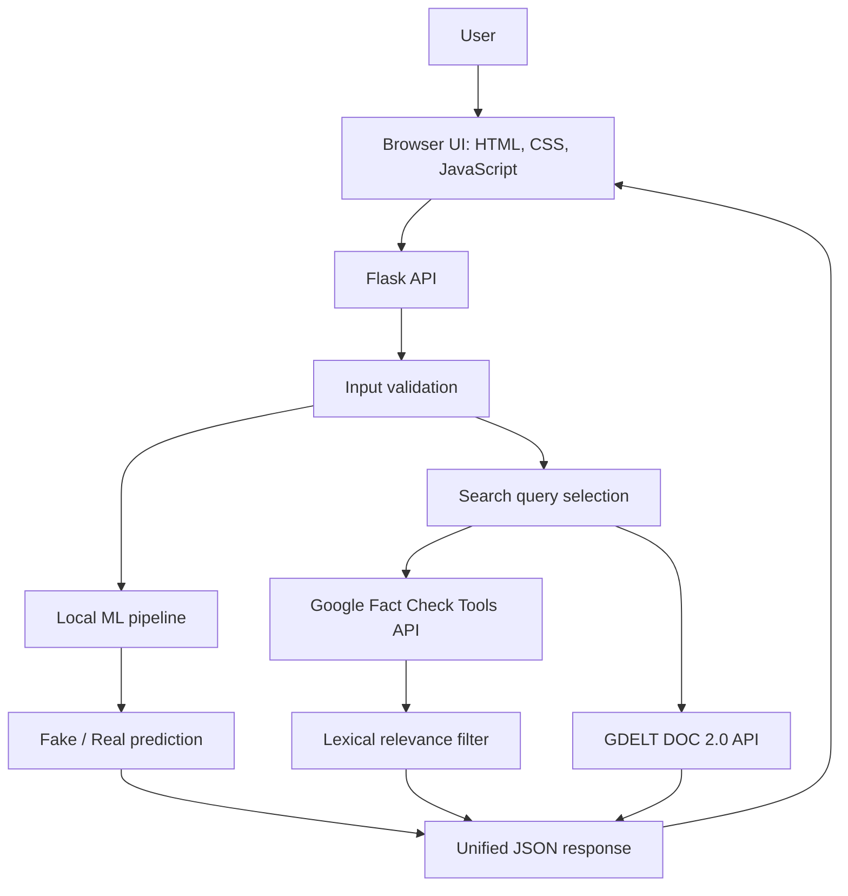

# VERITAS — System Architecture

## 1. High-level architecture

VERITAS uses a Flask backend to coordinate a local machine-learning prediction and two independent external evidence lookups. The browser interface sends the headline and article text to the backend and renders the returned data.

The ML pipeline and external evidence services are separate branches. The external results do not alter the ML prediction or its confidence value.

## 2. Frontend

The frontend is served from Flask:
- HTML defines the page structure and input fields.
- CSS provides layout and visual styling.
- JavaScript submits JSON requests to `/api/analyze`, handles the response, and renders the prediction and evidence panels.

The interface accepts a headline and pasted article text. URL extraction is not included in this version.

## 3. Backend

The Flask application is located at `webapp/app.py`. It provides:
- `GET /` — render the web interface.
- `GET /api/health` — health check.
- `POST /api/analyze` — unified analysis.
- `POST /api/predict` — legacy ML-only prediction.
- `POST /api/fact-check` — standalone fact-check lookup.
- `POST /api/news-coverage` — standalone news-coverage lookup.

Before analysis, the backend validates JSON types, headline and article size, minimum article length, and basic repetitive-text conditions.

## 4. Machine-learning path

The model is loaded once when `webapp/predictor.py` is imported. The saved artifact is expected at the repository root as `fake_news_model.joblib`.

Processing:
1. Trim headline and article text.
2. Join them into one input string.
3. Pass the text to the saved scikit-learn pipeline.
4. The pipeline transforms the text with its fitted TF-IDF vectorizer.
5. Logistic Regression predicts the class and class probabilities.
6. Map class `0` to Fake and class `1` to Real.

The model output describes resemblance to patterns learned from WELFake; it is not a factual verdict.

## 5. Fact-check evidence path

The `webapp/factcheck.py` module calls the Google Fact Check Tools claims search endpoint. The API key is read from the `GOOGLE_FACT_CHECK_API_KEY` environment variable, loaded from the root `.env` file when present.

Returned claim records may include the claim text, claimant, claim date, and publisher review details. VERITAS then compares normalized query and claim tokens:
- `direct_match`
- `related`
- `irrelevant`

Only direct and related results are placed in the relevant claims list; irrelevant results are placed in the excluded list. The score represents query-term coverage. It is a lexical heuristic, not semantic similarity, a probability, or an assessment of truth.

## 6. News-coverage evidence path

The `webapp/gdelt.py` module queries the GDELT DOC 2.0 API in ArtList mode. The unified analysis currently requests up to 10 matching articles from a three-month timespan, sorted by date descending.

Returned article metadata may include title, URL, domain, publication timestamp, language, source country, and image. A matching article or a large number of articles does not prove a claim.

## 7. Unified response and fault isolation

The `/api/analyze` endpoint first obtains the model prediction. It then attempts the fact-check and GDELT lookups independently.

Each external source returns its own status:
- `success` when its lookup completes.
- `unavailable` when the service call or response processing fails.

An external-service failure is non-fatal to the unified endpoint. If the ML prediction succeeds, the API can still return HTTP 200 with one or both evidence sources marked unavailable. If the ML prediction fails, the endpoint returns an error response and does not proceed with the external lookups.

## 8. Configuration and security notes

- Store the Google API key in `.env` as `GOOGLE_FACT_CHECK_API_KEY=...`.
- Keep `.env` out of version control.
- Do not log or return the API key. The fact-check client avoids exposing request URLs that contain the key.
- External requests use finite timeouts.
- The UI should disclose that search-derived text is sent to the external services.

## 9. Current scope

Included: pasted headline/article input, local ML classification, Google Fact Check Tools lookup, lexical relevance labels, GDELT news-coverage lookup, unified results, and graceful external-service failure handling.

Not included in this version: article URL fetching or extraction, semantic claim matching, independent source credibility scoring, or automated determination of factual truth.
