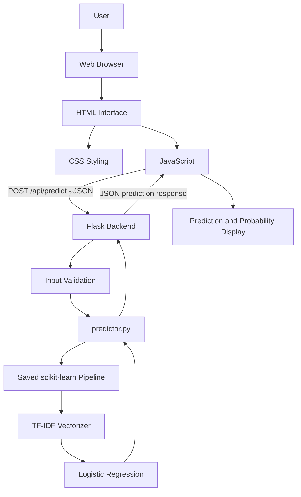
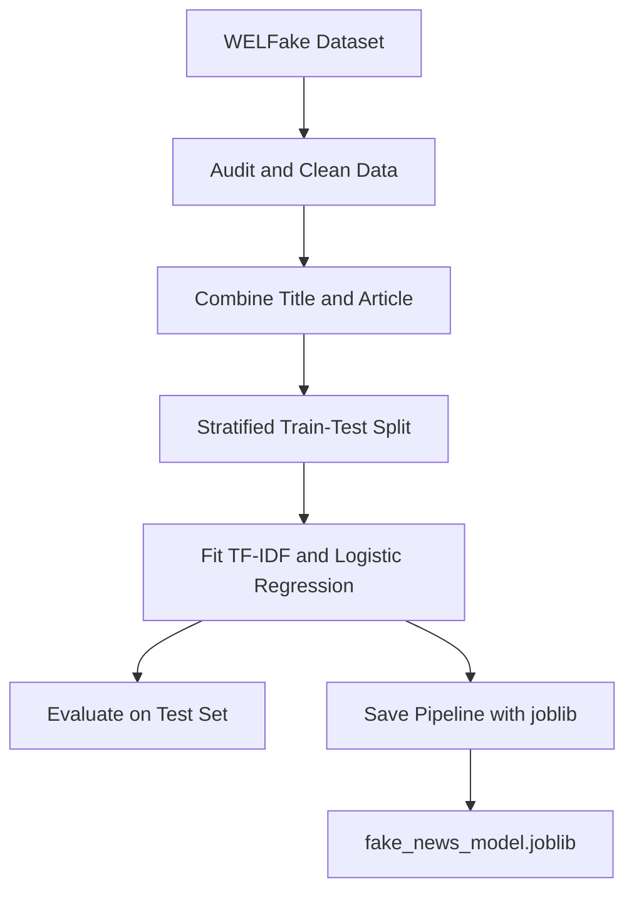
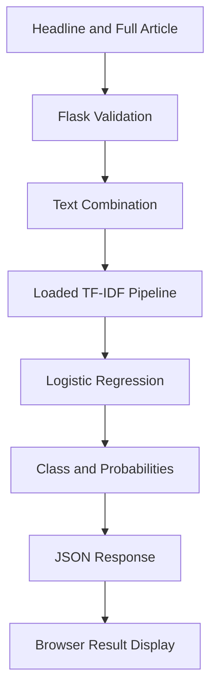

# System Architecture

## 1. Architecture Overview

VERITAS follows a simple client-server architecture. The browser presents the user interface, while a local Flask application receives requests, validates the submitted text, and calls the saved machine-learning pipeline to generate a prediction.

The machine-learning pipeline consists of a fitted TF-IDF vectorizer followed by a Logistic Regression classifier. Both components are saved together in `fake_news_model.joblib`.

The application is designed to run locally. Prediction requests are sent to the Flask backend on the same machine; the current prediction workflow does not require a paid AI API or an external inference service.

## 2. High-Level Architecture



The diagram represents the prediction path. The Flask application also serves the initial HTML page and exposes a separate health-check endpoint.

## 3. Main Components

### 3.1 Frontend — Browser Interface

**Location:** `webapp/templates/index.html`, `webapp/static/css/style.css`, `webapp/static/js/app.js`

The frontend is responsible for collecting user input, communicating with the backend, and displaying the returned result.

- **HTML:** Defines the page structure, headline and article fields, action buttons, result section, model information and disclaimers.
- **CSS:** Provides the visual design, responsive layout, loading indicator, result meters and reduced-motion styling.
- **JavaScript:** Reads the input, performs client-side checks, sends the prediction request, handles responses and errors, and updates the result display.

The JavaScript sends a JSON request to the relative endpoint `/api/predict`. It uses the browser Fetch API and sets a 30-second request timeout with an `AbortController`.

The browser does not run the machine-learning model. Prediction is performed by the Python backend.

### 3.2 Backend — Flask Application

**Location:** `webapp/app.py`

Flask acts as the web server and application backend.

Its responsibilities include:

- Serving the main page at `GET /`.
- Providing the health-check endpoint at `GET /api/health`.
- Receiving prediction requests at `POST /api/predict`.
- Parsing and validating JSON input.
- Enforcing title and article length limits.
- Requiring a full article and rejecting certain repetitive or low-quality inputs.
- Calling the prediction function.
- Returning the result as JSON.
- Handling expected validation errors and unexpected internal errors.

The backend is responsible for enforcing the full-article requirement. Client-side checks improve the user experience, but server-side validation remains authoritative.

### 3.3 Prediction Module

**Location:** `webapp/predictor.py`

The prediction module separates model inference from the Flask route logic.

At application startup, it:

1. Determines the project root using the location of the Python file.
2. Locates `fake_news_model.joblib` in the project root.
3. Checks that the model file exists.
4. Loads the fitted scikit-learn Pipeline using joblib.

For each valid prediction request, `predict_news(title, article)`:

1. Removes surrounding whitespace from the title and article.
2. Combines them into a single text string.
3. Calls the loaded model's `predict()` method.
4. Calls `predict_proba()` to obtain class-probability estimates.
5. Maps class ID `0` to `Fake` and class ID `1` to `Real`.
6. Returns the prediction, label, confidence percentage and probabilities for both classes.

The model is loaded once when the module is imported, rather than being loaded again for every request.

### 3.4 Machine-Learning Pipeline

**Artifact:** `fake_news_model.joblib`

The saved artifact contains the fitted scikit-learn Pipeline:

```text
Combined title + article text
             |
             v
     Fitted TF-IDF Vectorizer
             |
             v
      Logistic Regression
             |
             v
       Predicted class
       + probabilities
```

The TF-IDF vectorizer converts the text into numerical features using the vocabulary and weighting learned during training. Logistic Regression then produces the class prediction and probabilities.

Because the vectorizer and classifier are stored together, the same fitted text transformation is used during inference as during training.

## 4. Request and Response Flow

### 4.1 Page loading

1. The user opens `http://127.0.0.1:5000/`.
2. Flask handles `GET /`.
3. Flask renders `templates/index.html`.
4. The browser loads the stylesheet and JavaScript from the `/static/` directory.
5. The user sees the VERITAS interface.

### 4.2 Prediction request

1. The user enters a headline and the full article text.
2. Frontend JavaScript reads the values and performs basic client-side checks.
3. The browser sends a `POST /api/predict` request with a JSON body.
4. Flask parses the JSON and checks the input types, lengths, article presence and article quality.
5. If validation succeeds, Flask calls `predict_news(title, article)`.
6. The prediction module combines the text and passes it to the loaded Pipeline.
7. The TF-IDF vectorizer transforms the text.
8. Logistic Regression predicts the class and class probabilities.
9. The prediction module maps the class ID to its readable label and calculates the predicted-class confidence percentage.
10. Flask returns the result and a disclaimer as JSON.
11. JavaScript reads the response and updates the prediction label, confidence value and Fake/Real probability meters.

### 4.3 Error handling

If the request is invalid, Flask returns a JSON error message with HTTP status `400`. If an unexpected server-side exception occurs, the application logs the exception and returns a generic error with HTTP status `500`.

The frontend handles unsuccessful responses, invalid response data, network errors and requests that exceed its 30-second timeout. It displays an appropriate message rather than treating an unsuccessful request as a prediction.

## 5. API Layer

The Flask application exposes the following routes:

| Method | Route | Responsibility |
|---|---|---|
| GET | `/` | Renders the web interface. |
| GET | `/api/health` | Returns a basic API health response. |
| POST | `/api/predict` | Validates input and returns a model prediction. |

The prediction request uses JSON:

```json
{
  "title": "Example news headline",
  "article": "The full text of the news article goes here..."
}
```

A successful response includes:

- `status`
- `result.prediction`
- `result.label`
- `result.confidence`
- `result.probabilities.Fake`
- `result.probabilities.Real`
- `disclaimer`

For the complete request and response specifications, see [API_DOCUMENTATION.md](API_DOCUMENTATION.md).

## 6. Data and Model Flow

The training workflow and application inference workflow are separate.

### Training workflow



Training and evaluation are performed using the project's data and model scripts. The web application uses the already saved model artifact; it does not retrain the model for each user request.

### Inference workflow



## 7. Project Directory and Component Relationships

```text
CAPSTONE/
│
├── fake_news_model.joblib       # Saved fitted ML pipeline
│
├── train_model.py               # Model training
├── compare_models.py             # Algorithm comparison
├── evaluate_model.py             # Model evaluation
├── clean_data.py                 # Dataset cleaning
├── audit_data.py                 # Dataset audit
│
├── docs/
│   ├── API_DOCUMENTATION.md
│   ├── MODEL_DOCUMENTATION.md
│   ├── PROJECT_OVERVIEW.md
│   ├── SYSTEM_ARCHITECTURE.md
│   └── TESTING.md
│
└── webapp/
    ├── app.py                    # Flask routes and validation
    ├── predictor.py              # Model loading and inference
    ├── templates/
    │   └── index.html            # Page structure
    └── static/
        ├── css/
        │   └── style.css         # Presentation and layout
        └── js/
            └── app.js            # Browser-side interaction
```

The model artifact is expected in the project root, one directory above `webapp/`.

## 8. Runtime and Deployment Configuration

The application is configured for local development.

- **Framework:** Flask
- **Host:** `127.0.0.1`
- **Port:** `5000`
- **Debug mode:** Enabled in the current development configuration
- **Local address:** `http://127.0.0.1:5000`

Run the application from the `webapp` directory:

```powershell
python app.py
```

The project uses Flask, not FastAPI. The current configuration is intended for local demonstration and development, not direct public production deployment. Debug mode should be disabled and a production-ready WSGI server and appropriate security configuration should be used before deploying publicly.

## 9. External Dependencies and Privacy

The prediction path uses the local Flask backend and the locally loaded model artifact. It does not call a paid AI API or an external inference service.

The interface and application are designed to run locally. Article text is sent from the browser to the Flask application on the same machine for processing. The current implementation does not include a remote database, user account system or external prediction provider.

## 10. Architectural Limitations

- The architecture performs text classification, not independent fact verification.
- The model's predictions depend on patterns and labels in the WELFake training dataset.
- The system is designed for English news text.
- The model was trained on combined title and article text, so the backend requires the full article.
- Model confidence is a probability estimate and not a guarantee of factual correctness.
- The Flask server is configured for local development; additional security and deployment work is required before public hosting.

## 11. Summary

VERITAS uses a modular architecture in which the browser interface, Flask backend, prediction module and saved machine-learning pipeline have separate responsibilities. The frontend collects input and presents results, Flask manages requests and validation, the prediction module handles model inference, and the fitted TF-IDF plus Logistic Regression Pipeline generates the classification output.

This separation keeps the web interface independent of the model implementation and allows the trained pipeline to be reused without retraining during normal application use.
